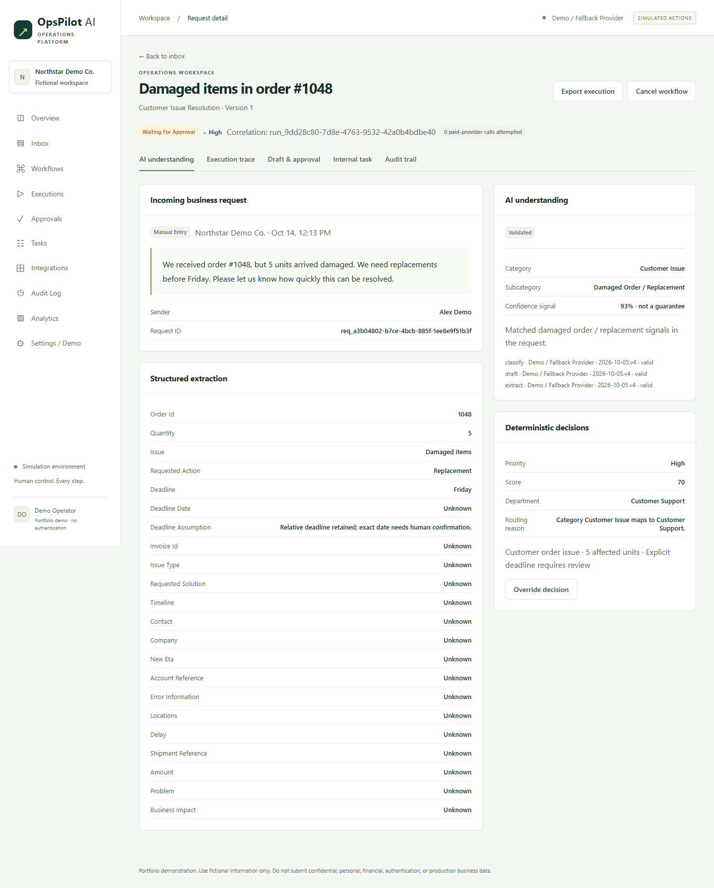
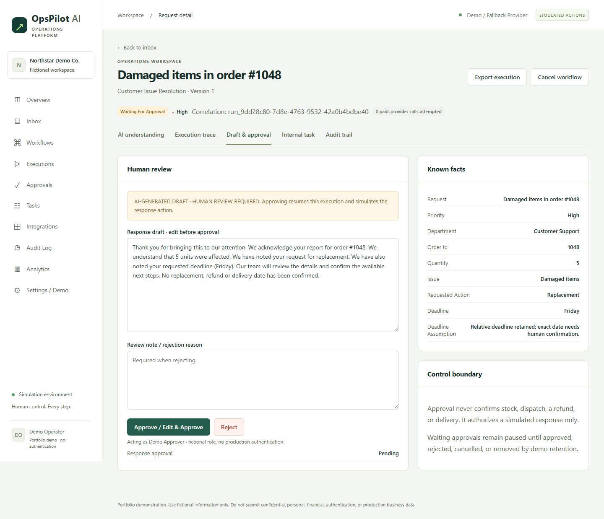

# OpsPilot

### Clear context. A controlled next step.

An independent, AI-assisted portfolio project by **Miridon Sadiku**. OpsPilot demonstrates how a team can keep an incoming request, its internal task, an editable response and the approval history together in one traceable case.

**[Open the showcase website](https://mimsadiku60-bot.github.io/opspilot-showcase/)** · **[Try the live demo](https://opspilot.159-89-22-244.sslip.io/)** · **[Discuss a scoped workflow](https://www.linkedin.com/in/mim-sadiku-ai-automation/)**

> **Portfolio demonstration only.** All example data are fictional. External actions are simulated. Public AI uses a deterministic fallback provider, not paid AI. Do not enter personal, confidential or production business information.

## The problem

A message is only the start of the work. Someone must understand it, route it, follow up on the internal task and review the response. The next person should not have to reconstruct that context from separate notes.

**The example:** order #1048 arrives with five damaged units. The customer asks for replacements before Friday. OpsPilot retains the request, displays the known facts, routes the case to Customer Support and pauses at human review. The exact calendar date remains unconfirmed.

**The visible benefit:** the reviewer has the request, task, decision and next step together. This is a demonstrated workflow pattern, not a claim of measured time savings or customer adoption.

## Two genuine product views

### 1. Request context and structured facts



The original message stays visible. Missing information remains unknown rather than being presented as verified. The confidence signal shown in the interface is not a measured accuracy guarantee.

### 2. Editable response and human approval



The reviewer can edit, approve or reject. Approval authorises a simulated response only; it does not confirm stock, replacement, refund or delivery.

*Both screenshots were captured from the hosted portfolio demo on 14 October 2026. They show the same fictional request waiting for approval. They are not live availability indicators or customer case studies.*

## 60-second demonstration guide

This is a presentation script, **not a recorded video**. Open the live demo, choose **Run demo scenario** and select the damaged-order example. Start the walkthrough when the case is waiting for approval. Records in the shared demo can expire or be reset.

| Time | Show | Explain |
|---|---|---|
| 00–15s | **AI understanding** | The request, order #1048, five affected units and Friday deadline are together. The exact date is unknown. |
| 15–30s | **Internal task** | The review task and its department are linked to the case. Routing is not fulfilment. |
| 30–45s | **Draft & approval** | A person reviews or edits the draft, then approves the fictional response. |
| 45–60s | **Execution trace / Audit trail** | Inspect the decision and simulated result. No outside message is sent; the internal task still needs follow-up. |

## Simplified architecture

```text
Manual entry / fictional scenario
              |
       Node.js request API
              |
 Demo/fallback interpretation + deterministic rules
              |
       Linked internal task
              |
  Human review: edit / approve / reject
              |
       Simulated response

SQLite retains requests, execution state, tasks, drafts,
approvals, attempt history and audit events.
```

GitHub supports source control, automated checks and the approved deployment process. It is not the customer-data store. This showcase contains presentation files only; the application repository and deployment configuration remain private.

## Demonstrated scope

Structured requests, rule-based priority and routing, persistent tasks, editable drafts, human approval/rejection/cancellation, execution and audit history, controlled failure and explicit bounded retry.

## Not implemented as live client capabilities

- Gmail, Outlook, Slack, ATS, CRM, n8n and Make account integrations.
- Real outbound messages or business actions.
- Production authentication, tenant isolation or enterprise access controls.
- Automatic candidate assessment or hiring decisions.

“Demo Operator” and “Demo Approver” are attribution labels, not authenticated identities. Optional AI configuration does not add authentication or enable real external actions.

A client implementation requires separate scope, access-control and data-handling work, integrations, testing and acceptance criteria. No paid customer deployment, revenue result, uptime guarantee or compliance certification is claimed here.

## About this public repository

English-language showcase for prospective clients and technical reviewers in Europe and beyond. The screenshots contain fictional business information only. No private application source, its Git history, database, credentials or server configuration are included.

No open-source licence is granted for the private application by publishing this presentation.
